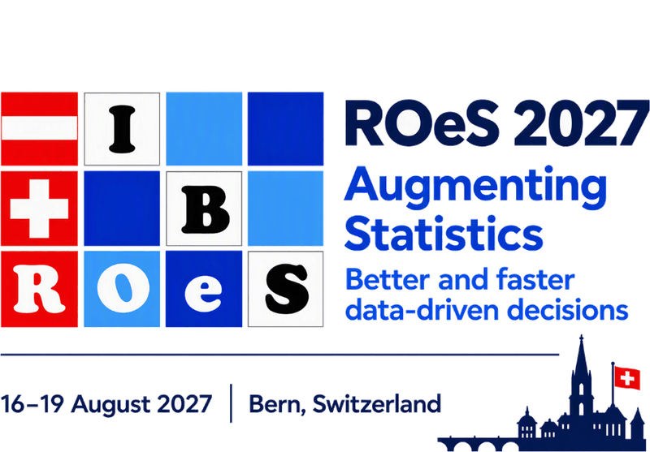

::: {.column-screen}
```{=html}
<section class="hero" style="background-image:url('img/ST_Bern-Rosengarten_36720_compressed.jpg');">
  <div class="hero__scrim">
    <div class="hero__content">
      <div class="hero__logo-card">
        <picture>
          <source media="(min-width: 768px)" srcset="img/roes2027-logo-wide.png">
          
        </picture>
      </div>
      <h1 class="hero__title">35<sup>th</sup> Conference of the Austro-Swiss Region (ROeS)</h1>
      <p class="hero__subtitle">of the International Biometric Society (IBS)</p>
      <div class="hero__actions">
        <a class="btn-cta" href="key-dates.html">Key Dates</a>
        <a class="btn-cta btn-cta--ghost" href="committees.html">Committees</a>
      </div>
    </div>
  </div>
  <span class="hero__credit">© Bern Welcome</span>
</section>
```
:::

::: {.column-page}
```{=html}
<div class="facts">
  <div class="fact">
    <i class="bi bi-calendar-event"></i>
    <span class="fact__label">When</span>
    <span class="fact__value">16&ndash;19 August 2027</span>
  </div>
  <div class="fact">
    <i class="bi bi-geo-alt"></i>
    <span class="fact__label">Where</span>
    <span class="fact__value">University of Bern<br>Switzerland</span>
  </div>
  <div class="fact">
    <i class="bi bi-people"></i>
    <span class="fact__label">Host</span>
    <span class="fact__value">Austro-Swiss Region (ROeS)<br>of the IBS</span>
  </div>
</div>
```
:::

::: {.column-page .news-section}

::: {.callout-important}
# Latest News

**The calls for invited sessions, topic-contributed sessions and short courses are now open:**  
Submit your proposals for [invited sessions](calls.qmd#invited-sessions), [topic-contributed sessions](calls.qmd#topic-contributed-sessions) and [short courses](calls.qmd#short-courses) by **Friday, 11<sup>th</sup> December 2026**. Notification of acceptance will follow by Wednesday, 23<sup>rd</sup> December 2026. See [Calls](calls.qmd) for details.

**The ROeS 2027 website is up and the conference date and location are confirmed:**  
The 35<sup>th</sup> Conference of the [Austro-Swiss Region (ROeS)](https://www.ibs-roes.org) of the [International Biometric Society (IBS)](https://www.biometricsociety.org) will take place from 16<sup>th</sup> to 19<sup>th</sup> August 2027, at the [**University of Bern**](https://www.unibe.ch) in [**Bern**](https://bern.com)**, Switzerland**.

:::

:::

<!--  -->

